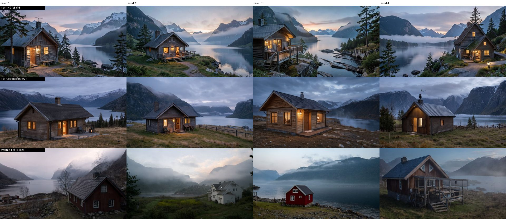
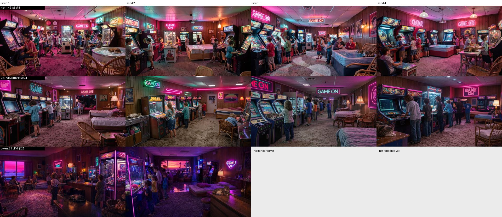
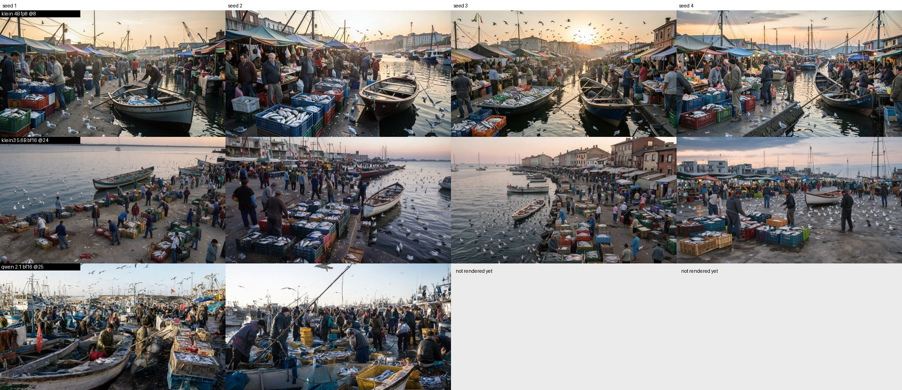

# Model comparison: one model family for most workflows (#95, part of #64)

Goal: pick **one model family** for wallpapers, edits, explore and drafts, so one character LoRA (and maybe a
vaporwave style LoRA) covers them. This file keeps the evidence so anyone can reuse or redo it. Candidates and
newer models: #75. Numbers are from one machine, so compare them with each other, not with yours.

## Test machine
Windows 11 + WSL2 (Ubuntu 24.04), AMD RX 9070 XT 16 GB (gfx1201), ROCm 7.2, ComfyUI v0.41.0-19, WSL RAM ~24 GB +
16 GB swap, resource limits on (`comfy/limits.sh on`). Quality first: up to about 5 minutes an image is fine.

## Candidates
| Preset | Model | Files (disk) | Steps | Licence | Install |
|---|---|---|---|---|---|
| `klein` | FLUX.2 klein 4B fp8 | 3.8 GB + 7.5 GB encoder | 4 (16 for fewer quirks) | Apache-2.0 | `models/flux2-klein.sh` |
| `klein3` | FLUX 3 Image Klein 5.6B bf16 (no fp8 exists) | 11.1 GB + 8.9 GB encoder | 16, no CFG | FLUX Kommunity (free under $5M), gated on Hugging Face | `models/flux3-klein.sh` |
| `qwen` | Qwen-Image 2.1 bf16 | 14 GB + 17 GB encoder | 25 | Qwen Research (non-commercial) | `models/qwen-image-2.1.sh` |

## Test set (fixed: every model gets exactly this, and a new model later gets run on it too)
Same prompts, seeds (1, 2) and size (1344x768) for every model, all in one session so timings compare.
Each model runs at its own steps (klein 4 and 16, klein3 16, qwen 25).

| # | Prompt | Style | What it tests |
|---|---|---|---|
| 1 | `a cozy cabin by a misty fjord at dusk` | none | The baseline from the first klein vs qwen sweep (2026-11-24); plain scene, mood, light |
| 2 | `a crowded 80s arcade at night, kids at the cabinets, a cat asleep on a counter, a claw machine, a neon sign that says "GAME ON"` | `synthwave` (the house style) | Busy scene in the house look; sign text; funny details |
| 3 | `a busy harbour market at dawn, photorealistic documentary photograph, fishermen, crates of fish, gulls, a tilted rowing boat, many people` | none | Busy scene, realistic; people, hands, crowds |
| 4 | character from a reference image (tulu) | | Character fidelity: `gen bakeoff --t2i ... --ref IMG --ref-prompt "scene"` |

## How to rerun
```
gen sweep "a cozy cabin by a misty fjord at dusk" -p klein,klein3,qwen --steps klein=4,16 --steps klein3=16 --steps qwen=25 --seeds 2 --size 1344x768
gen sweep "a crowded 80s arcade at night, kids at the cabinets, a cat asleep on a counter, a claw machine, a neon sign that says \"GAME ON\"" -p klein,klein3,qwen --steps klein=4,16 --steps klein3=16 --steps qwen=25 --seeds 2 --size 1344x768 --style synthwave
gen sweep "a busy harbour market at dawn, photorealistic documentary photograph, fishermen, crates of fish, gulls, a tilted rowing boat, many people" -p klein,klein3,qwen --steps klein=4,16 --steps klein3=16 --steps qwen=25 --seeds 2 --size 1344x768
```
The sheet (`index.html` in each run folder) and the table `gen sweep` prints give time and peak VRAM/RAM per cell.

## Results

Run on 2026-11-24 to 2026-11-27 on the machine above. Seeds: cabin 2139207221-24, arcade 2299944486-89, market 3336029649-52,
size 1344x768. The grids below show the final settings, four seeds per row (full-size originals stay in the output folder).

### Final settings per model
| Model | Steps | Why |
|---|---|---|
| klein 4B fp8 | 8 | 4 is fine for drafts; 16 and 32 change composition more than quality, and 32 garbles signs more |
| klein3 5.6B bf16 | 24 | Very stable from 8 to 32. 24 was the best on the cabin seed that grows a second door at 16 and 32 (Þór); arcade 24 to 32 about equal, slightly cleaner at 32 (Þór) |
| qwen 2.1 bf16 | 25 | 15 is darker and muddier; 25 and 40 look the same |

### Time and memory (warm = after the first image of a run, which includes loading the model)
| Model @ steps | Warm per image | First image (cold load) | Peak VRAM GiB | System RAM GiB (comfy RSS) | Swap while running |
|---|---|---|---|---|---|
| klein @8 | about 7.5 s | 15 to 106 s | about 6 (9.5 at load) | 14.6 (13.2) | about 1.5 GiB |
| klein @16 | 12 to 15 s | | about 6 | 14.6 (13.4) | about 1.5 GiB |
| klein3 @24 | 31 to 38 s | 31 to 144 s | 10.5 to 12 | 21.1 (about 20) | 1.2 to 2 GiB |
| klein3 @16 | about 20 to 25 s | up to 208 s | 11.7 | 21.0 (about 20) | 1.1 to 1.3 GiB |
| qwen @25 | 150 to 220 s (up to 305 s with a shared GPU) | 235 to 319 s | about 11.7 | 22.2 to 22.8 (about 20.7) | 5.4 to 5.8 GiB (comfy), about 6 (system) |

Sources: the tables `gen sweep` prints, and the timing line of the final render. klein3 times in the steps sweep jumped between 17 and 217 s
per image with no pattern (something else was using the PC), so the warm klein3 numbers come from the cleaner runs. klein3 runs bf16 and
uses about 7 GiB more RAM than klein, close to qwen's 22 GiB, which is near the soft `MemoryHigh=21G` in `comfy/limits.conf`.

### Final grids (rows: klein @8, klein3 @24, qwen @25; columns: seeds 1-4)
A grey cell means that image has not been rendered yet.

Cabin: `a cozy cabin by a misty fjord at dusk`


Arcade (house style `synthwave`): `a crowded 80s arcade at night, kids at the cabinets, a cat asleep on a counter, a claw machine, a neon sign that says "GAME ON"`


Market: `a busy harbour market at dawn, photorealistic documentary photograph, fishermen, crates of fish, gulls, a tilted rowing boat, many people`


### Baseline impressions (2026-11-24, fjord prompt, before klein3)
- **klein 4B**: warmer, illustration-like, fewer notable artifacts. About 7 s warm, 4 steps.
- **Qwen-Image 2.1**: darker and more realistic, but "still feels off". About 3 minutes an image, RAM maxed.
- Both showed artifacts.

### Written assessment
Þór's own observations are marked (Þór); the rest are Claude's reads from downscaled previews and not an artifact count.

- **klein 4B fp8:** the warmest and most "cozy" look: golden light, lit windows, pines, decks. Reads literally on the 80s interior (waterbed with a
  cat, wood panelling) and keeps "GAME ON" legible. Composition depends on steps and seed (cabin seed 1 jumps from distant to close-up at 16 steps).
  Sign text beyond the main one is often garbled. Fast and light: about 7.5 s an image and 6 GiB VRAM. More stylised than photographic.
- **klein3 5.6B bf16:** a cooler, quieter dusk and believable cabins (wood cladding, steep roofs); the most photographic of the family. Very
  stable across steps. Arcade: fewer kids and less crowded than klein, signs mostly cleaner ("GAME ON"), garbled text on cabinets. Market: wide, top-down
  compositions with many gulls. Cabin seed 1 grows a second door at 16 and 32 steps (Þór). Noticeably different from klein (Þór). About 4 to 5 times klein's time
  and 7 GiB more RAM.
- **qwen 2.1 bf16:** the moodiest and densest: best mist, darkest neon (arcade), the busiest and most realistic market. Seed-to-seed it varies the most on what
  a "cozy cabin" is (white farmhouse, red cabin, weathered veranda cabin). Slowest by far (150 to 300 s) and RAM maxed with swap. 25 to 40 steps is not much better (Þór).
- **Overall:** no huge difference at first look (Þór), but klein vs klein3 do differ in feel. Not yet decided: see below.

### Not done yet
- The qwen arcade and market cells for seeds 3 and 4, and the final tallies of visible artifacts per image (Þór counts from the grids: garbled text, duplicated doors, odd hands or faces, melted objects).
- The edit comparison (`gen bakeoff PATH "instruction" -p klein,klein3,qwen`, #64 A) and the character-reference test (#4 in the test set).

## LoRA support and tooling
A LoRA works for one model family only, so this can outweigh a small quality gap. Plan: a character LoRA used in
masked inpaint/edit passes (#56), maybe a style LoRA for the scene (not a replacement for the CRT post step).

| Family | Loads in ComfyUI | Training on a 16 GB RX 9070 XT (WSL2, ROCm 7.2) | Existing LoRAs |
|---|---|---|---|
| FLUX.2 klein 4B | `LoraLoaderModelOnly` (to verify) | ai-toolkit guide for RX 9070 in WSL2 exists, Flux "maybe"; musubi-tuner klein LoRAs shown on AMD Strix Halo | to check |
| FLUX 3 klein 5.6B | to verify | none found yet (see #75) | to check |
| Qwen-Image 2.1 | to verify | guides assume 24 GB+; option: train on a rented GPU, run locally | to check |

## Decision
Not made yet. Record the pick, the reason and the date here, then switch the presets (#64 A-C, explore stage,
the cast pass) and update #75.
